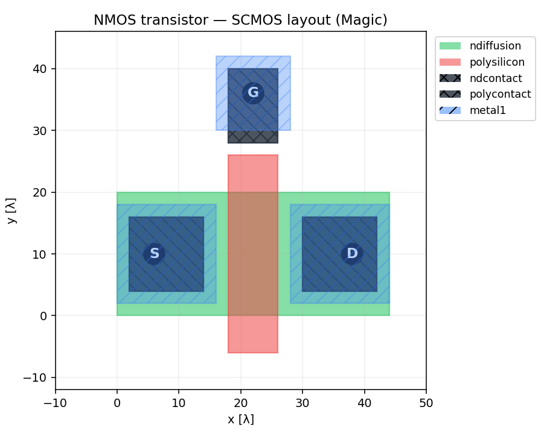
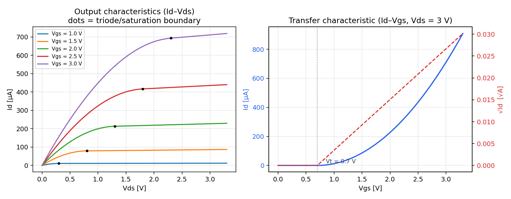

# NMOS Layout and Model

A small training project in chip design: one NMOS transistor drawn layer by layer in the Magic VLSI editor, and a simple model of how its current responds to voltage.



`nmos.mag` is a hand-drawn layout with SCMOS rules: n-diffusion for the source and drain, a polysilicon gate across the active area, contacts, and metal-1 wiring to the three terminals. `nmos_iv.py` is a square-law (Level-1) model with channel-length modulation, with the width and length taken from the layout. It plots the output and transfer characteristics and estimates the threshold voltage.



## Run

```bash
pip install -r requirements.txt
python render_layout.py   # layout figure, no Magic installation needed
python nmos_iv.py         # I-V curves
```

To open the layout itself: `magic nmos.mag`.

---

Yaşar Aykut Altuntop · Koç University · [LinkedIn](https://linkedin.com/in/aykutaltuntop) · [GitHub](https://github.com/Aykut0)
